# 유희준 (UHeeJoon)

**Backend Engineer · Java / Spring**

추측하기보다 **측정하고 재현해서** 문제를 확인하는 백엔드 개발자입니다.
멀티테넌트 SSO 인증 서비스를 신규 구축 TF에서 처음부터 설계했고, 장애가 나도 **서비스와 데이터가 버티는 구조**를 만드는 데 집중해 왔습니다.

---

## Experience

**총 1년 7개월** (정규직 11개월, 인턴 8개월)

### (주)옥타코 · Backend 팀원 (2025.04 – 2026.02)

멀티테넌트 SSO 신규 구축 TF(백엔드 3명)에서 고객사 판별(Resolve Server), Redis 세션, 데이터 격리, 인프라를 담당했습니다.

- **장애 격리** — Chaos Monkey로 Redis 장애를 재현해 전체 로그인 중단을 확인하고, Circuit Breaker + DB Fallback으로 Redis 장애 중에도 인증이 이어지도록 개선
- **캐시** — 인증 정책을 Redis Cache-Aside로 캐시해 적중률 *97% 이상*, TTL Jitter + Single Flight로 동시 만료에도 DB 조회 *인스턴스당 1회*
- **성능** — 50만 건 부하 시험으로 검색 지연을 발견, pg_trgm GIN 인덱스와 UNION 분리로 쿼리 *987ms → 20ms*
- **데이터 격리** — 고객사별 Schema 분리(Hibernate Multi-Tenancy), 실패 시 보상 트랜잭션으로 되돌리는 고객사 온보딩 서비스
- **인프라** — EKS 전환, Helm 공통 Template + Argo CD로 배포 *30분 → 10분 이내*, IRSA로 서비스별 최소 권한 분리

### (주)모빌씨앤씨 · Backend 대학 연계 인턴 (2024.08 – 2025.03)

- 인턴 팀 백엔드 리더로 역할 분배와 코드 리뷰 담당
- 알림을 Polling에서 SSE + Redis Pub/Sub으로 전환, Timeout · Circuit Breaker로 장애 전파 차단

---

## Projects

### [Search Platform](https://github.com/UHeeJoon/search-platform) — 게시글 검색 · 에스크로 결제

`Spring Boot` `MySQL` `Elasticsearch` `Kafka` `Debezium` `Saga` `k6` · 개인 프로젝트 (F-Lab 멘토링)

- 검색 구현을 단계별로 바꿔 같은 부하로 측정 → Elasticsearch 전환으로 조건이 매번 다른 검색 p95 *42.7초 → 549ms*
- 결제 트랜잭션 안에서 게시글을 선점해 동시 결제 *이중 판매 0건*
- 환불 Saga의 실패를 재시도 가능/불가로 나누고 보상 트랜잭션 도입, 원장 기준 건별 대사로 *정산 누락 1건* 발견 · 보정

### [NOVA](https://github.com/Nova-Grandis/be) — 사전예약 서비스
`Spring Boot` `MySQL` `Valkey` `SQS` `Resilience4j` `Terraform` `k6` · LG U+ 유레카 부트캠프 9인 팀

10초에 5,000명이 몰리는 사전예약 서비스에서 AWS 인프라와 접수 · 대기열 · 외부 연동 worker를 담당했습니다.

- Lock 시점을 늦춰 Lock 구간 SQL을 7개 → 3개로 줄이고 접수 응답 p50 *521ms → 48ms*
- 대기열 조회 간격 계산을 고쳐 입장 지연 p95 *31초 → 3초*
- Transactional Outbox + SQS + DLQ로 외부 등록 유실 방지, 응답에 따라 스스로 조절하는 동시 요청 한도

### Team · Personal

---

## Tech Stack

**Backend**

**Data & Messaging**

**Infra & DevOps**

-326CE5?style=flat-square&logo=kubernetes&logoColor=white)

---

## GitHub & PS

**AI Coding Usage**

---

## Certification

- **CKA** (Certified Kubernetes Administrator) — 2026.09
- **정보처리기사** — 2026.09
- **AWS SAA-C03** (Solutions Architect – Associate) — 2026.07
- **SQLD** — 2026.06

## Education

- **한신대학교** 정보통신학부 졸업 (2019.03 – 2025.02)
- **LG U+ 유레카 부트캠프** (2026.04 – 2026.10)
- **코리아 IT 아카데미** Java/Spring 웹개발 · SQLD 과정

> 공부한 내용은 [기술 블로그](https://codding-til-theory.tistory.com)에 기록하고 있습니다.

---

